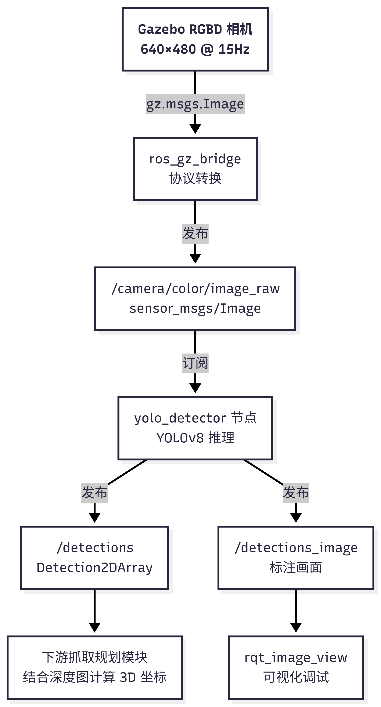
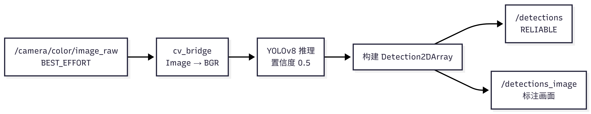
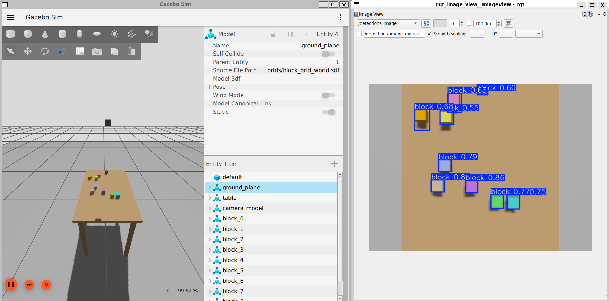

# 第3章 基于 YOLO 的视觉感知

**学习目标**

- 理解 YOLO 单阶段检测的核心原理与设计思想
- 掌握在 COCO 数据集上完成训练、评估、推理的完整流程
- 了解 ROS2 节点/话题通信模型与 Gazebo 仿真平台的基本概念
- 掌握仿真环境下域随机化场景生成、自动标注、YOLO 训练及 ROS2 节点部署的全链路
- 理解感知模块输出的数据格式及其对下游抓取规划的接口意义

---

## 3.1 视觉感知在具身智能中的角色

具身智能系统的运行可概括为三个环节：感知 → 规划 → 执行。感知回答"目标在哪"，规划回答"怎么够到"，执行完成动作。感知手段多样——视觉、触觉、激光雷达、力觉等各有适用场景。其中视觉感知因其信息密度高、硬件成本低、技术成熟度好，是当前最广泛使用的感知模态。本章聚焦于视觉感知中的目标检测环节。

视觉感知的基本链路：相机采集 RGB 图像 → 目标检测算法定位物体 → 输出物体在图像中的位置。但实际机器人操作需要的是**三维世界坐标**，而非二维像素坐标。从 2D 像素到 3D 世界坐标的转换是数据升维，仅靠单一的图像信息不足，通常还依赖以下信息之一：

- **深度**：普通彩色相机每个像素记录的是颜色（RGB），而深度相机每个像素记录的是该点到相机光心的物理距离（单位通常为米），称为深度值。RGBD 相机（如 RealSense）同时输出彩色图和深度图。像素 $(u, v)$ 处有了颜色信息可做检测，有了深度值 $d$ 再结合相机内参，即可将该像素反投影为 3D 空间中的一个点。
- **多视角几何**：多个相机或移动相机通过三角测量恢复深度。
- **先验知识**：已知物体真实尺寸，通过成像大小反推距离。

在本章的仿真环境中，Gazebo 的 RGBD 相机同时发布彩色图和深度图（话题 `/camera/depth/image_raw`）。YOLO 负责在彩色图上检测目标、输出 2D 边界框；深度信息可在下游模块中与检测结果对齐，完成 2D → 3D 的坐标转换。本章聚焦 YOLO 检测本身，2D 到 3D 的融合细节将在涉及抓取规划的后续章节展开。

YOLO 在本章的角色是：快速、可靠地从 RGB 图像中定位所有候选操作对象，输出归一化的 2D 边界框坐标。这一检测结果作为感知输出，为下游的抓取规划提供目标位置信息。

---

## 3.2 YOLO 速览：设计思想与工作原理

YOLO（You Only Look Once）是一种单阶段目标检测算法。其核心思想可概括为：将整张图像输入一个神经网络，单次前向传播即可同时预测所有物体的边界框位置和所属类别。相比需要分步执行"候选区域提取→分类"的传统方法，YOLO 将检测建模为端到端的回归任务，这使得推理速度达到实时级别（毫秒级），适合机器人等对延迟敏感的场景。

YOLO 系列自 2016 年提出以来经历了多个版本的迭代（v1 → v8 → v10 → v11 等），本章实践基于目前工程生态最成熟的 YOLOv8。以下从检测问题的本质出发，逐步展开 YOLO 的核心工作机制。

### 3.2.1 目标检测问题的本质

目标检测需要同时回答两个问题：

- **定位（where）**：物体在图像的什么位置？
- **分类（what）**：这个物体是什么类别？

传统方法将这两个问题拆成串行步骤：先用滑动窗口或区域提议算法扫描全图，找到"可能有物体"的候选区域，再对每个区域单独运行分类器。计算量随候选区域数量线性增长，难以实时。

YOLO 的设计出发点是：将检测重新定义为一个单一的回归问题——直接从输入图像像素映射到边界框坐标和类别概率，中间不经过"区域提议→分类"的分步流水线。


<p class="caption">图3-1  YOLO 单阶段检测流程</p>

### 3.2.2 网格划分与单次前向传播

YOLO 将输入图像划分为 $S \times S$ 的网格（grid）。每个网格单元负责预测中心点落在该单元内的物体。单次前向传播后，每个网格单元输出：

- $B$ 个边界框（每个包含 $x, y, w, h$ 和置信度 $C$）
- $K$ 个类别概率

整张图的预测结果是一个 $S \times S \times (B \times 5 + K)$ 的张量。以 YOLOv8 在 $640 \times 640$ 输入下为例，最终输出约 8400 个候选框。

这个设计的核心效果是：无论图像中有多少物体，计算量基本恒定——不像两阶段方法随候选区域数线性增长。

### 3.2.3 边界框的表示

YOLO 输出的边界框采用中心点归一化坐标：

```text
class_id   x_center   y_center   width   height
   0        0.5234     0.4120    0.0875   0.0650
```

- `x_center`, `y_center`：框中心在图像中的相对位置（$0 \sim 1$，相对于图像宽高）
- `width`, `height`：框宽高（同样归一化到 $0 \sim 1$）
- `class_id`：类别编号，从 0 开始

归一化使坐标与图像分辨率解耦，模型可在任意尺寸输入上训练和推理。

### 3.2.4 置信度与后处理

每个边界框附带一个置信度分数（confidence score）：

$$\text{confidence} = P(\text{object}) \times \text{IoU}_{\text{pred}}^{\text{truth}}$$

其中 IoU（Intersection over Union，交并比）是衡量两个边界框重叠程度的指标，定义为两框交集面积除以并集面积。直观理解：IoU = 1 表示两框完全重合，IoU = 0 表示完全不重叠。因此置信度综合了两个信息——"框内很可能有物体"且"框的位置比较准"。

推理时实际使用类别条件概率：

$$P(\text{class}_i \mid \text{object}) \times P(\text{object}) \times \text{IoU}$$

后处理分两步：

1. **置信度过滤**：丢弃置信度低于阈值（如 0.5）的框。
2. **非极大值抑制（NMS）**：对同一物体的多个重叠框，只保留置信度最高的，抑制 IoU 超过阈值（如 0.7）的重复框。

NMS 后每个物体仅保留一个最优边界框。

### 3.2.5 评估指标：mAP

mAP（mean Average Precision，平均精度均值）是目标检测的核心指标。先理解两个基础概念：

- **IoU（Intersection over Union）**：预测框与真实框的交集面积除以并集面积，衡量定位精度。
- **Precision 与 Recall**：当一个预测框与某个真实框的 IoU ≥ 阈值且类别正确时，记为 TP（True Positive，正确检测）；没有匹配到任何真实框的预测框记为 FP（False Positive，误检）；没有被任何预测框匹配到的真实框记为 FN（False Negative，漏检）。由此定义：

$$\text{Precision} = \frac{\text{TP}}{\text{TP} + \text{FP}}, \quad \text{Recall} = \frac{\text{TP}}{\text{TP} + \text{FN}}$$

改变置信度阈值会产生不同的 (Precision, Recall) 对，连成 P-R 曲线，曲线下面积即为 Average Precision（AP）。对所有类别取平均得到 mAP。

常见两种 mAP 变体，如表 3-3 所示。

| 指标 | 含义 | 用途 |
|------|------|------|
| mAP@0.5 | IoU ≥ 0.5 即算正确 | 宽松评估，衡量"是否找到物体" |
| mAP@0.5:0.95 | IoU 从 0.5 到 0.95 步长 0.05 取平均 | COCO 官方标准，严格考察定位精度 |

<p class="caption">表3-3  常用 mAP 指标及其含义</p>

不同 mAP@0.5 数值对应的大致表现：

- **0.9 以上**：几乎每个物体都被找到，框的位置也很准。
- **0.5 左右**：大多数物体能被找到，但存在一定比例的漏检或定位偏差。本章实验一中 COCO 10 类训练 50 轮后约 0.55，属于典型的入门级结果。
- **0.2 及以下**：模型只能稳定检测少数几个"简单"类别，多数类别要么大量漏检，要么框的位置偏差很大。此时需要检查数据质量、增加训练轮数或换用更大模型。

实际中，mAP 的高低取决于三个因素：数据质量（标注是否准确、覆盖是否全面）、场景复杂度（目标大小、遮挡程度、类内差异）和模型容量（参数量是否匹配任务难度）。

### 3.2.6 YOLOv8 模型族

YOLOv8 因其成熟的工程实现和广泛社区支持，是当前入门与部署的稳妥选择。Ultralytics 提供 5 种预训练规模，如表 3-4 所示。

| 模型 | 参数量 | COCO mAP50-95 | GPU 延迟 | 适用场景 |
|------|--------|---------------|----------|---------|
| YOLOv8n | 3.2M | 37.3 | ~2ms | 边缘设备、实时检测 |
| YOLOv8s | 11.2M | 44.9 | ~3ms | 精度要求稍高 |
| YOLOv8m | 25.9M | 50.2 | ~6ms | 桌面 GPU 首选 |
| YOLOv8l | 43.7M | 52.9 | ~9ms | 高精度场景 |
| YOLOv8x | 68.2M | 53.9 | ~12ms | 极致精度 |

<p class="caption">表3-4  YOLOv8 模型族对比</p>

本章统一使用 YOLOv8n：参数最少、训练最快。

---

## 3.3 实验一：在 COCO 数据集上初步实践 YOLO

### 3.3.1 基础知识

在进入实验之前，先了解目标检测数据集的组织方式和训练过程的基本概念。

**数据集格式。**一个目标检测数据集由图像文件和同名标注文件配对构成。标注文件为纯文本，每行描述一个目标，格式为：

```text
class_id  x_center  y_center  width  height
```

五个字段依次为：类别编号（从 0 开始）、边界框中心点横坐标、纵坐标、宽度、高度。四个坐标值均归一化到 $[0, 1]$ 区间，即以图像宽度和高度为分母。数据集通过 YAML 配置文件指定图像路径、标注路径和类别名称列表。例如 COCO10 的配置如下：

```yaml
# config/coco10.yaml
path: data/coco10
train: images/train
val: images/val
names:
  0: person   1: bicycle   2: car     3: motorcycle   4: bus
  5: truck    6: cat       7: dog     8: chair        9: bottle
```

**训练过程的关键概念。**训练时模型逐张读取图像，前向传播输出预测框，与标注真实框对比计算两个 loss——`box_loss`（边界框回归误差）和 `cls_loss`（分类误差），再通过反向传播更新网络参数。几个核心术语：

- **epoch**：完整遍历一次全部训练图像，称为一个 epoch。
- **batch**：每次参数更新使用的样本数。batch 越大，梯度估计越稳定，但显存占用越高。
- **验证集**：从训练数据中划分出的子集，不参与参数更新，仅用于每个 epoch 结束后评估模型在未见过的数据上的泛化表现。

Ultralytics 提供了高度封装的训练 API，核心调用如下：

```python
from ultralytics import YOLO
model = YOLO('yolov8n.pt')
model.train(data='config/coco10.yaml', epochs=50, batch=16, device='cuda:0')
```

**本实验中 mAP 的解读。**COCO10 上 YOLOv8n 训练 50 轮后的参考基线：mAP@0.5 约为 0.55。这一数值意味着模型已具备基本的检测能力——大部分目标能被找到，但定位精度和召回率仍有提升空间。逐类 AP 差异显著——形态一致、特征鲜明的类别（如公交车，AP ≈ 0.76）远好于形态多变、特征不明显的类别（如椅子，AP ≈ 0.27）。这一基线将作为后续仿真实验的参照。

### 3.3.2 实验概览

**实验目标。**在 COCO10 标准数据集上跑通 YOLO 训练→评估→推理的全流程，获得一个能够接收任意图片、输出图中物体位置和类别的检测模型。

**数据集简介。**本实验使用 COCO10——从 COCO 标准基准中筛选的 10 类子集（person, bicycle, car, motorcycle, bus, truck, cat, dog, chair, bottle），包含约 2800 张图片。相比完整 COCO（80 类、约 12 万张图片、~20GB），COCO10 规模小、下载快，适合入门练习。若算力充足，可直接使用完整 COCO（将 `coco10.yaml` 替换为 `coco.yaml`，epochs 提升至 100+）。

**实验流程。**

```text
数据集准备（下载+筛选） → 训练（50 epochs） → 评估（mAP） → 推理验证
```

**分析方法。**主要观察以下三个维度：

- 训练曲线：`box_loss` 和 `cls_loss` 随 epoch 是否持续下降，`mAP@0.5` 和 `mAP@0.5:0.95` 是否稳步上升
- 逐类 AP：哪些类别检测效果好、哪些差，分析原因
- 推理结果：在未见过的图片上目测检测框是否准确

### 3.3.3 环境准备

**系统要求。**

- **操作系统**：Ubuntu 24.04（原生安装为首选；WSL2 或 VMware 虚拟机也可运行，不影响训练和推理的正确性）
- **GPU**：NVIDIA 显卡 + CUDA ≥ 11.8（可选；纯 CPU 可跑，但训练耗时增加 5~10 倍）
- **内存**：≥ 8 GB。磁盘：≥ 20 GB 空闲

**创建 Conda 环境。**使用交付包中提供的 `environment_coco.yml` 创建实验一专用环境：

```bash
conda env create -f environment_coco.yml
conda activate yolo_coco
```

验证安装：

```bash
python -c "import torch; print(f'CUDA: {torch.cuda.is_available()}')"
python -c "from ultralytics import YOLO; print('ultralytics OK')"
```

实验一的全部操作在 `yolo_coco/` 目录下进行。目录结构如下：

```
yolo_coco/
├── config/
│   ├── coco10.yaml          # COCO10 数据集配置（10 类）
│   └── coco.yaml            # 全量 COCO 配置（80 类，20GB）
├── scripts/
│   ├── prepare_coco10.py    # 下载并筛选 COCO10
│   ├── train.py             # 训练脚本
│   ├── evaluate.py          # 评估脚本
│   └── detect.py            # 推理脚本
└── data/
    └── coco10/              # 下载后生成的数据集目录
```

### 3.3.4 快速开始

如果已按 3.3.3 节完成环境配置，依次执行以下步骤即可跑通实验一全流程：

```bash
cd yolo_coco
conda activate yolo_coco

# 1. 下载并准备 COCO10 数据集
python scripts/prepare_coco10.py

# 2. 训练（约 35 分钟 / GPU）
python scripts/train.py --model yolov8n.pt --data config/coco10.yaml --epochs 50 --batch 16

# 3. 在验证集图片上推理，查看效果
python scripts/detect.py --model outputs/train/*/weights/best.pt --source data/coco10/images/val --save
```

训练完成后模型保存到 `outputs/train/<时间戳>/weights/best.pt`；推理结果（标注后的图片）保存到 `outputs/detect/`。详细参数说明见 3.3.5 节分步详解。

### 3.3.5 分步详解

#### 数据集准备

```bash
python scripts/prepare_coco10.py
```

脚本自动完成以下步骤：下载 COCO 标注和图片（约 500 MB）→ 筛选 10 类子集 → 确保每类不少于 200 个实例 → 按 80/20 划分训练集与验证集 → 输出到 `data/coco10/`。

#### 训练

```bash
python scripts/train.py \
  --model yolov8n.pt \
  --data config/coco10.yaml \
  --epochs 50 \
  --batch 16
```

| 参数 | 含义 | 推荐值 |
|------|------|--------|
| `--model` | 预训练权重 | `yolov8n.pt` |
| `--data` | 数据集配置文件 | `config/coco10.yaml` |
| `--epochs` | 训练轮数 | 50 |
| `--batch` | 批次大小 | 16（6 GB 显存；如显存不足（OOM），降为 8） |
| `--imgsz` | 输入图像尺寸 | 默认 640 |
| `--device` | 计算设备 | 自动检测 GPU，手动指定 `cpu` 可切换到纯 CPU 模式 |

训练产物位于 `outputs/train/<时间戳>/`：

| 文件 | 用途 |
|------|------|
| `weights/best.pt` | 验证集上 mAP 最高的模型权重 |
| `weights/last.pt` | 最后一个 epoch 的权重（用于续训） |
| `results.png` | 训练曲线图（loss 与 mAP 随 epoch 的变化） |

若显存不足，可减小 `--batch 8` 或降低输入分辨率 `--imgsz 320`。若训练意外中断，通过 `--resume` 从上一个 checkpoint 继续。

#### 评估

```bash
python scripts/evaluate.py \
  --model outputs/train/<时间戳>/weights/best.pt \
  --data config/coco10.yaml
```

输出指标：mAP@0.5、mAP@0.5:0.95、Precision、Recall、逐类 AP。

#### 推理

```bash
# 单张图片
python scripts/detect.py --model outputs/train/<时间戳>/weights/best.pt --source 图片.jpg --save

# 批量
python scripts/detect.py --model outputs/train/<时间戳>/weights/best.pt --source data/coco10/images/val --save
```

| 参数 | 说明 |
|------|------|
| `--conf 0.25` | 置信度阈值，低于该值的检测框被丢弃 |
| `--iou 0.7` | NMS 的 IoU 阈值 |
| `--save` | 保存标注后的图像到 `outputs/detect/` |

### 3.3.6 结果分析

训练完成后，在 `outputs/train/<时间戳>/` 目录下可查看 `results.png`，该图汇总了 loss 和 mAP 随 epoch 的变化趋势。如图 3-2 所示，box_loss 与 cls_loss 在整个训练过程中持续下降，表明模型在定位和分类任务上均在持续学习；mAP@0.5 与 mAP@0.5:0.95 则稳步上升，其中后者的增长幅度更大，说明模型不仅提高了"找到物体"的能力，在边界框的定位精度上进步更为明显。


<p class="caption">图3-2  COCO10 训练曲线</p>

表 3-1 列出了不同 epoch 下的具体指标数值（RTX 2060，50 epochs，约 35 分钟）。

| 轮数 | box_loss | cls_loss | mAP@0.5 | mAP@0.5:0.95 |
|------|----------|----------|---------|---------------|
| 10 | 1.319 | 1.572 | 0.443 | 0.273 |
| 20 | 1.216 | 1.338 | 0.488 | 0.310 |
| 30 | 1.155 | 1.179 | 0.519 | 0.333 |
| 50 | 0.997 | 0.856 | **0.538** | 0.353 |

<p class="caption">表3-1  COCO10 训练各阶段指标</p>

从表 3-1 可以看出：`box_loss` 从 1.319 降至 0.997，`cls_loss` 从 1.572 降至 0.856，模型在定位和分类两个任务上均在持续学习。mAP@0.5 从 0.443 提升至 0.538，mAP@0.5:0.95 从 0.273 提升至 0.353——后者增长幅度更大，说明模型不仅提高了"找到物体"的能力，在边界框定位精度上进步更为明显。30 到 50 epoch 之间提升速度放缓，表明模型已接近当前数据量下的性能上限。

**逐类 AP 分析。**COCO10 上不同类别的 AP 差异显著：公交车（AP ≈ 0.76）远好于椅子（AP ≈ 0.27）。原因在于：公交车形态方正、特征明显、类内一致性高；而椅子在形状、材质、视角上差异极大，属于公认的难检测类别。这一现象说明了目标检测任务中数据质量（类别样本的代表性）对模型效果的决定性影响。图 3-3 展示了训练完成的模型在 COCO10 验证集上的检测效果。


<p class="caption">图3-3  COCO10 检测结果示例</p>

---

## 3.4 实验二：在 Gazebo 仿真中部署 YOLO 实时检测

### 3.4.1 基础知识

实验二将 YOLO 从一个"接收图片、返回检测结果"的离线工具，转变为持续订阅相机图像流、实时发布检测结果的 ROS2 节点。这涉及三个关键组件：ROS2（机器人通信框架）、Gazebo（仿真平台）和自动标注（训练数据生成方法）。以下分别介绍。

#### 3.4.1.1 ROS2 核心概念

ROS2（Robot Operating System 2）是面向机器人软件开发的中间件框架，为分布式进程提供标准化的通信接口、生命周期管理和命令行工具。ROS2 基于 DDS（Data Distribution Service）实现实时数据分发，支持多节点在单机或多机间协同工作。

**节点（Node）。**ROS2 图中的基本计算单元，通常为单一可执行文件。每个节点封装一类功能（如图像采集、目标检测、运动规划），节点间通过话题、服务或动作交换数据。进程级隔离保证了单个模块的故障不会波及其他节点——例如检测节点崩溃不影响 Gazebo 仿真和机械臂控制器继续运行。

**话题（Topic）。**节点间异步通信的命名通道。发布者将消息写入话题，订阅者从话题接收消息；双方无需知晓对方的存在，仅通过话题名称和消息类型建立连接。这种解耦机制允许模块独立开发、测试和替换。例如，负责抓取规划的节点只需订阅 `/detections` 话题即可获取目标位置，无需关心检测是如何实现的。

**消息（Message）。**话题上传递的带类型数据结构。ROS2 定义了丰富的标准消息类型，例如 `sensor_msgs/Image` 表示图像、`vision_msgs/Detection2DArray` 表示一组二维检测结果。消息类型定义确保了数据格式在发布者和订阅者之间的兼容性。

**本章涉及的话题。**实验二中涉及两个 ROS2 话题：

| 话题 | 消息类型 | 方向 | 含义 |
|------|----------|------|------|
| `/camera/color/image_raw` | `sensor_msgs/Image` | Gazebo → 检测节点 | RGB 图像输入 |
| `/detections` | `vision_msgs/Detection2DArray` | 检测节点 → 下游 | YOLO 检测结果（归一化边界框、类别、置信度） |

<p class="caption">表3-5  实验二涉及的 ROS2 话题</p>

#### 3.4.1.2 Gazebo 仿真平台

Gazebo 是开源三维机器人仿真环境，集成刚体动力学引擎（DART/Bullet）、传感器模型（相机、激光雷达、IMU 等）和渲染引擎。其核心作用是：在实际硬件部署前，在虚拟环境中完成算法开发与验证。

**SDF 世界文件。**SDF（Simulation Description Format）是 Gazebo 使用的 XML 格式场景定义文件，描述仿真世界的静态结构——包括光照、地面、桌面、待操作物体以及传感器安装参数。本实验的 `block_grid_world.sdf` 由 `generate_grid_world.py` 脚本生成，每次运行随机改变方块的位置、颜色和形状。

**RGBD 相机仿真。**Gazebo 的 RGBD 相机插件同步输出彩色图像和深度图像，两者像素一一对齐。仿真相机以固定频率（如 15 Hz）生成图像帧，并通过 ros_gz_bridge 发布为 ROS2 话题。本实验的相机固定于桌面正上方俯瞰，内参为 $f_x = f_y = 554.25$, $c_x = 320$, $c_y = 240$。

**ros_gz_bridge。**Gazebo 内部使用 `gz.msgs` 格式的消息（如 `gz.msgs.Image`），ROS2 使用标准 `sensor_msgs` 等格式，两者不兼容。ros_gz_bridge 充当协议转换器，使 ROS2 节点可以透明地订阅仿真传感器数据，无需关心底层是仿真还是真实硬件。

#### 3.4.1.3 自动标注原理

目标检测是监督学习任务，训练需要标注数据——即每张图像中每个目标物体的边界框和类别。传统方式由人工逐张绘制标注框，对于数百张图像的数据集，标注成本显著。本章实验二的训练数据量需求在 200~500 张图像，若手工标注将耗费大量时间。

本实验利用仿真的独特优势解决这一问题：仿真场景由程序生成，场景中每个物体的三维位置、尺寸和姿态在生成时即为已知量，记录在元数据文件中。利用这些已知的 3D 信息反向计算 2D 标注，可以实现全程零人工干预。

**域随机化策略。**如果每次生成的仿真场景完全相同（如方块固定在 3×3 网格中心），训练出的检测模型可能仅"记住"9 个固定的目标位置，而非学习到目标的视觉特征。域随机化策略通过在每次场景生成时改变以下维度来解决这一问题：

- **位置**：方块在桌面范围内随机散布（而非固定网格）
- **颜色**：从预设色板中随机选取
- **形状**：正方体与圆柱体混合

随机化迫使模型从多样化的样本中提取与位置无关的视觉特征——模型学到的不再是"第 3 行第 2 列有个方块"，而是"图像中看起来像方块的物体都在哪里"。

**针孔相机投影。**将世界坐标系下的三维点 $(X_w, Y_w, Z_w)$ 转换为像素坐标 $(u, v)$ 的过程分为两步。

第一步，刚体变换，将世界坐标平移至相机坐标系。本实验中相机固定于桌面正上方 $(0.5, 0.0, 1.5)$，俯视无旋转，因此变换退化为平移：

$$X_c = X_w - 0.5,\quad Y_c = Y_w,\quad Z_c = 1.5 - Z_w$$

第二步，透视投影，将三维相机坐标映射到像素平面：

$$u = f_x \cdot \frac{X_c}{Z_c} + c_x,\quad v = f_y \cdot \frac{Y_c}{Z_c} + c_y$$

其中 $f_x, f_y$ 为焦距（以像素为单位），$c_x, c_y$ 为光心在图像平面上的像素坐标。代入本实验的相机参数，$f_x = f_y \approx 554.25$, $c_x = 320$, $c_y = 240$。

**从 3D 包围盒到 2D 边界框。**物体的为长方体（正方体或圆柱的包围盒），有 8 个顶点。将 8 个顶点分别执行上述投影，得到 8 个像素坐标。取这些像素坐标的最小外接矩形：

$$u_{\min} = \min\{u_1, \ldots, u_8\},\quad v_{\min} = \min\{v_1, \ldots, v_8\}$$
$$u_{\max} = \max\{u_1, \ldots, u_8\},\quad v_{\max} = \max\{v_1, \ldots, v_8\}$$

该矩形即为物体在图像中的 2D 边界框。

**标注生成流程。**自动标注脚本 `auto_label_grid.py` 的执行流程如下：

1. 读取 `block_grid_world_meta.json`，获取当前场景中所有方块的 3D 坐标和尺寸。
2. 对每个方块，计算其 8 个顶点的世界坐标。
3. 将顶点投影到像素平面，计算外接边界框。
4. 将边界框转换为 YOLO 格式：归一化到 $[0,1]$，写入 `block_dataset/train/labels/` 目录中与图像同名的 `.txt` 文件。

**边界情况处理。**当方块部分位于相机视野外时，部分顶点的投影坐标可能为负或超出图像分辨率（$640 \times 480$）。标注脚本在计算外接矩形后，将边界框裁剪至 $[0, 640] \times [0, 480]$ 有效区域，确保标注值合法。本实验的仿真场景中，相机正上方俯瞰、方块间无堆叠，因此不存在遮挡问题。若读者修改相机视角或增加物体重叠，需额外处理遮挡情况下的标注容错。

### 3.4.2 实验概览

**实验目标。**将 YOLO 嵌入 ROS2 节点，在 Gazebo 方块检测场景中完成从场景生成到实时检测的完整闭环。

**系统架构。**实验二的系统由三个独立进程组成，通过 ROS2 话题串联为一条数据流，如图 3-5 所示。



<p class="caption">图3-5  系统架构数据流</p>

两个关键设计保证了系统的可迁移性：

- **消息协议适配**：Gazebo 使用 `gz.msgs.Image`，ROS2 使用 `sensor_msgs/Image`。ros_gz_bridge 完成协议转换，图像内容本身不被修改。
- **图像源解耦**：检测节点只订阅 `/camera/color/image_raw` 话题，不区分图像来自仿真还是真实相机。将仿真中验证通过的代码迁移到真机时，仅需将图像源从 Gazebo 的 bridge 替换为真实相机驱动节点。

**实验流程。**本实验包含从数据到部署的完整闭环：

```text
生成随机场景 → 多次采集图像 → 自动标注 → 训练检测模型 → 构建 ROS2 包 → 一键部署运行
```

**分析方法。**

- 系统级验证：使用 `ros2 topic hz`、`ros2 topic echo` 等命令确认数据流各环节正常
- 定量对比：固定网格场景（`--fixed`）与随机位置场景下训练模型的 mAP 差异，分析域随机化对泛化能力的影响
- 定性检查：通过 rqt_image_view 观察实时检测画面上标注框的准确性和稳定性

**快速开始选项。**读者有两种方式进入本实验：

- **全链路模式**：按 3.4.5 节分步详解逐一执行，从场景生成一直做到部署运行。
- **快速部署模式**：跳过场景生成与训练，直接使用交付包中预训练的 `block_best.pt` 模型，仅执行 3.4.4 节的一键启动命令，体验 YOLO 在 ROS2 中的实时检测效果。

### 3.4.3 环境准备

**安装 ROS2 Jazzy。**

```bash
sudo apt update && sudo apt install software-properties-common -y
sudo add-apt-repository universe
sudo apt install curl -y
sudo curl -sSL https://raw.githubusercontent.com/ros/rosdistro/master/ros.key \
  -o /usr/share/keyrings/ros-archive-keyring.gpg
echo "deb [arch=$(dpkg --print-architecture) signed-by=/usr/share/keyrings/ros-archive-keyring.gpg] \
  http://packages.ros.org/ros2/ubuntu $(. /etc/os-release && echo $UBUNTU_CODENAME) main" \
  | sudo tee /etc/apt/sources.list.d/ros2.list > /dev/null

sudo apt update
sudo apt install ros-jazzy-desktop -y
```

**安装 Gazebo Harmonic。**

```bash
# 通过 ROS2 vendor 包安装，自动匹配版本
sudo apt install ros-jazzy-ros-gz-sim ros-jazzy-ros-gz-bridge -y
```

验证安装：

```bash
gz sim --version      # 应输出 Gazebo Harmonic 版本号
```

**创建 Conda 环境。**使用交付包中提供的 `environment_vision.yml` 创建实验二专用环境：

```bash
cd yolo_vision
conda env create -f environment_vision.yml
conda activate yolo_vision
```

验证安装：

```bash
python -c "import torch; print(f'CUDA: {torch.cuda.is_available()}')"
python -c "from ultralytics import YOLO; print('ultralytics OK')"
source /opt/ros/jazzy/setup.bash
ros2 topic list          # 应无报错（状态列表可能为空，正常）
```

**构建工作空间。**

```bash
cd yolo_vision
source /opt/ros/jazzy/setup.bash
conda activate yolo_vision
colcon build --symlink-install
source install/setup.bash
```

`--symlink-install` 使用符号链接安装 Python 脚本和资源文件，后续修改源码无需重新编译。

**项目结构。**实验二涉及的目录和文件：

```
yolo_vision/                         ← ROS2 检测包
├── worlds/
│   └── block_grid_world.sdf         ← 由脚本生成的仿真场景
├── launch/
│   └── sim_detect.launch.py         ← 一键启动文件
├── yolo_vision/
│   └── detector_node.py             ← YOLO 检测节点实现
└── models/                          ← 预训练模型目录

scripts/                             ← 工具脚本（独立于 ROS2 包）
├── generate_grid_world.py           ← 场景生成 + 域随机化
├── collect_training_data.py         ← 图像采集工具
├── auto_label_grid.py               ← 自动标注脚本
└── train_yolo_block.py              ← 方块检测模型训练

block_dataset/                       ← 训练数据集（共享目录）
├── data.yaml                        ← 数据集配置
├── train/
│   ├── images/                      ← 采集的 RGB 图像
│   └── labels/                      ← 自动生成的 YOLO 标注
└── val/                             ← 训练时自动划分的验证集
```

### 3.4.4 快速开始

**快速部署模式。**使用预训练的 `block_best.pt` 模型，跳过场景生成和训练，直接部署运行：

```bash
cd yolo_vision
source /opt/ros/jazzy/setup.bash
conda activate yolo_vision
source install/setup.bash

ros2 launch yolo_vision sim_detect.launch.py
```

启动后：Gazebo 窗口自动打开并显示随机方块场景，ros_gz_bridge 自动桥接相机数据，YOLO 检测节点自动加载模型并开始实时推理。

在另一个终端中查看检测结果：

```bash
source /opt/ros/jazzy/setup.bash
conda activate yolo_vision
ros2 run rqt_image_view rqt_image_view /detections_image
```

**可选启动参数：**

| 参数 | 默认值 | 说明 |
|------|--------|------|
| `world` | `block_grid_world.sdf` | 仿真世界文件路径 |
| `model` | `best.pt` | YOLO 模型权重文件 |
| `confidence` | `0.5` | 置信度阈值 |

### 3.4.5 分步详解

以下按全链路模式逐一执行——从场景生成到训练再到部署。若已在 3.4.4 节通过快速部署模式成功运行，可跳过本节的步骤一至步骤四，直接阅读步骤五理解检测节点的内部机制。

#### 步骤一：生成仿真场景

```bash
python3 scripts/generate_grid_world.py
# 输出: yolo_vision/worlds/block_grid_world.sdf
#       yolo_vision/worlds/block_grid_world_meta.json
```

**默认行为**：每次运行生成随机位置的方块世界——9 个方块（含 1~3 个圆柱体）在桌面（$80 \times 60$ cm）范围内随机散布，颜色随机。每次生成同时输出 `block_grid_world_meta.json`，记录各方块的实际三维坐标与尺寸，供步骤三自动标注使用。

常用选项：

```bash
python3 scripts/generate_grid_world.py --seed 42          # 固定随机种子，可复现
python3 scripts/generate_grid_world.py --num_blocks 15    # 增加方块数量
python3 scripts/generate_grid_world.py --fixed             # 固定 3×3 网格（用于对比实验）
```

场景参数：RGBD 相机固定于 $(0.5, 0.0, 1.5)$ 正上方俯瞰，分辨率 $640 \times 480$，帧率 15 Hz。方块边长约 4 cm。

#### 步骤二：采集训练图像

本步骤需要同时开启三个终端。

**终端 1** — 启动 Gazebo：

```bash
gz sim -r yolo_vision/worlds/block_grid_world.sdf
```

**终端 2** — 启动 ros_gz_bridge：

```bash
source /opt/ros/jazzy/setup.bash
ros2 run ros_gz_bridge parameter_bridge \
    /camera/color/image_raw@sensor_msgs/msg/Image[gz.msgs.Image
```

注意：末尾的 `[` 表示单向桥接（GZ → ROS2），不是双向桥接的 `@`。若误写为 `@`，bridge 会因为找不到 ROS2 端的发布者而报错。

**终端 3** — 采集图像：

```bash
source /opt/ros/jazzy/setup.bash
conda activate yolo_vision
python3 scripts/collect_training_data.py
```

| 按键 | 功能 |
|------|------|
| `Space` | 保存当前帧 |
| `S` | 连续模式：每 0.5 秒自动保存一帧（再按停止） |
| `Q` / `Esc` | 退出采集程序 |

图像保存至 `block_dataset/train/images/`。建议重复执行步骤一和步骤二多次（每次使用不同的 `--seed` 值），累计采集 200~500 张覆盖不同随机位置的图像。图 3-4 展示了 Gazebo 中随机生成的一个示例场景。


<p class="caption">图3-4  Gazebo 仿真场景</p>

#### 步骤三：自动标注

```bash
python3 scripts/auto_label_grid.py
```

脚本读取 `block_grid_world_meta.json` 中的方块三维坐标，通过针孔相机模型投影（投影原理详见 3.4.1.3 节），生成 YOLO 格式的标注文件，输出至 `block_dataset/train/labels/`，与步骤二采集的图像一一对应。每一步标注全程无需人工参与。

#### 步骤四：训练方块检测模型

```bash
python3 scripts/train_yolo_block.py
```

脚本依次完成：检查图像与标注文件的对应关系 → 按 80/20 划分训练集/验证集并生成 `data.yaml` → 基于 YOLOv8n 预训练权重微调 → 将训练得到的 `best.pt` 复制到 `yolo_vision/models/` 供部署使用。

训练参数：基座 `yolov8n.pt`，100 epochs，imgsz 640，batch 16，patience 20（连续 20 轮无改善则提前终止）。表 3-2 列出了固定网格与随机位置两种场景下的预期结果（RTX 2060，200+ 张训练图像）。

| 指标 | 固定网格（`--fixed`） | 随机位置（默认） |
|------|----------------------|-----------------|
| mAP@0.5 | ~0.995 | ~0.88–0.94 |
| mAP@0.5:0.95 | ~0.983 | ~0.80–0.90 |
| 训练时长 | ~80 s | 3–5 min |

<p class="caption">表3-2  固定网格与随机位置训练结果对比</p>

固定网格场景下 mAP 接近 1.0，并非模型泛化能力强，而是模型"记住"了 9 个固定位置——每次生成的场景中方块位置完全相同，模型只需学会输出固定的 9 个边界框即可。随机位置场景下 mAP 降至 0.88–0.94，说明模型被迫学习了方块的视觉特征本身而非位置模式——这是域随机化的预期效果，mAP 的"下降"在此处衡量的是泛化能力的"上升"。

#### 步骤五：构建并部署 ROS2 检测节点

```bash
cd yolo_vision
source /opt/ros/jazzy/setup.bash
conda activate yolo_vision
colcon build --symlink-install
source install/setup.bash
```

检测节点 `detector_node.py` 的内部处理流水线如图 3-6 所示。



<p class="caption">图3-6  检测节点内部处理流水线</p>

QoS 策略根据数据特性分别选择：

| 方向 | 话题 | QoS 策略 | 原因 |
|------|------|----------|------|
| 订阅 | `/camera/color/image_raw` | BEST_EFFORT, depth=1 | 图像以 15 Hz 持续推送，偶尔丢帧不影响检测 |
| 发布 | `/detections` | RELIABLE, depth=10 | 检测结果必须可靠送达下游规划模块 |

### 3.4.6 结果分析

**系统运行验证。**启动后，新开终端加载环境，依次执行以下命令确认各环节正常：

```bash
source /opt/ros/jazzy/setup.bash
conda activate yolo_vision

ros2 topic hz /camera/color/image_raw    # 应输出约 15 Hz，确认相机持续发布图像
ros2 topic hz /detections                # 应与相机帧率一致，确认检测节点正常输出
ros2 topic echo /detections --once       # 读取一次检测结果，检查消息结构
```

`/detections` 每条消息包含 `detections` 列表，每个元素含 `bbox`（归一化边界框）、`results`（类别 ID 和置信度）。`ros2 topic hz /detections` 输出频率应接近相机帧率（15 Hz），说明 YOLO 推理未造成显著延迟。

**实时检测效果。**图 3-7 展示了 rqt_image_view 中显示的实时检测画面，边界框准确覆盖每个检测到的方块，框上标注了类别名与置信度。图 3-8 展示了域随机化场景下的检测效果，方块随机散布在桌面各处，YOLO 仍能准确标注每个目标，置信度在 0.70–0.92 之间。


<p class="caption">图3-7  实时检测结果（/detections_image 话题画面）</p>



<p class="caption">图3-8  域随机化场景检测效果</p>

**固定网格 vs 随机位置对比。**步骤四训练结果表（见 3.4.5 节步骤四）揭示了域随机化对泛化能力的影响：

- 固定网格下 mAP@0.5 ≈ 0.995，模型几乎"完美"——但这是因为方块的绝对位置从未改变，模型只需要输出固定的预测框。这种模型在方块移动到新位置时会完全失效。
- 随机位置下 mAP@0.5 ≈ 0.88–0.94，虽然数值上低于固定网格，但模型具备了处理任意位置的泛化能力——验证集中的方块位置与训练集完全不同，模型仍需正确检测。这一结果是域随机化有效性的直接证据。

---

## 3.5 感知输出：为下游抓取做好准备

本章产出的检测节点对外暴露两个话题：

| 话题 | 消息类型 | 内容 | 下游消费方式 |
|------|----------|------|-------------|
| `/detections` | `vision_msgs/Detection2DArray` | 归一化边界框 + 类别 ID + 置信度 | 抓取规划模块订阅，结合深度图（`/camera/depth/image_raw`）计算目标 3D 坐标 |
| `/detections_image` | `sensor_msgs/Image` | YOLO 标注后的画面 | rviz2 或 rqt_image_view 可视化调试 |

<p class="caption">表3-6  检测节点输出的两个话题</p>

下游模块执行 `ros2 topic echo /detections` 即可获取所有目标的归一化坐标和类别信息，无需了解 YOLO 的内部实现。这是 ROS2 发布/订阅模型的核心价值：接口标准化后，模块可独立开发和替换。YOLO 检测节点可以被任何输出 `Detection2DArray` 消息的检测器替代（如 RT-DETR、DETR 等），对下游模块完全透明。

本章检测节点仅输出 2D 像素坐标。将 2D 检测结果转换为机械臂可用的 3D 世界坐标，需要结合深度图（Gazebo RGBD 相机同步发布 `/camera/depth/image_raw`）和相机内参进行反投影计算。深度信息与检测框的对齐、相机坐标系到机器人基座坐标系的变换等步骤，将在涉及抓取规划的后续章节展开。

读者完成本章后，应能理解 YOLO 在机器人感知系统中所处的位置：作为感知层的核心组件，其输出——标准化的目标检测结果——是下游规划与控制模块的起点。

---

## 3.6 拓展任务

| # | 任务 | 难度 | 说明 |
|---|------|------|------|
| 1 | 换用 YOLOv8s 训练 COCO10，对比精度与速度 | ★ | 训练时将 `--model` 改为 `yolov8s.pt` |
| 2 | 增加方块数（`--num_blocks 25`）或改为 `--fixed` 固定网格，对比 mAP 差异并分析原因 | ★★ | 理解数据多样性对泛化能力的影响 |
| 3 | 为不同颜色方块分配不同 `class_id`，训练多分类检测器 | ★★ | 单类检测扩展为多类，为颜色分拣场景做准备 |
